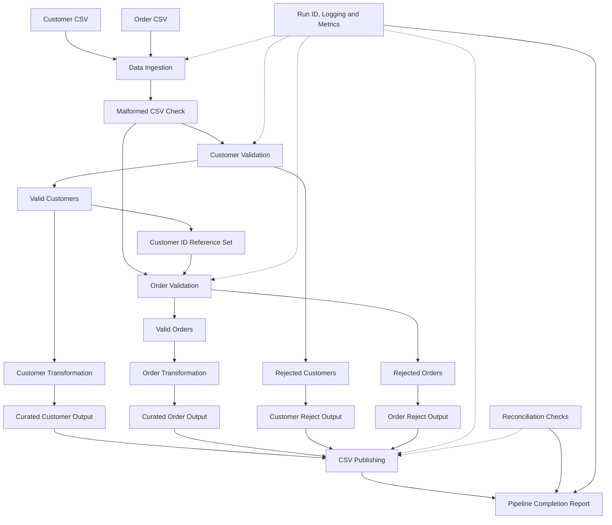

# YottaFlex Batch Data Pipeline – Architecture

## 1. Overview

The YottaFlex batch pipeline processes customer and order CSV files through ingestion, validation, transformation, and publishing stages.

The pipeline separates valid records from rejected records, generates execution metrics, and performs reconciliation checks to ensure data consistency.

## 2. Architecture Diagram

## 3. Pipeline Execution Flow

1. **Data Ingestion:** Reads customer and order CSV files.
2. **Malformed Record Detection:** Identifies structurally invalid CSV rows, such as records with an incorrect number of columns.
3. **Customer Validation:** Checks required fields, duplicate customer IDs, and email format.
4. **Order Validation:** Checks required fields, duplicate order IDs, customer references, order dates, amounts, and order statuses.
5. **Transformation:** Standardizes customer fields and converts order dates and amounts into appropriate data types.
6. **Publishing:** Writes accepted records into curated CSV files and rejected records into separate reject files.
7. **Monitoring:** Captures run IDs, timestamps, execution duration, record counts, and pipeline errors.
8. **Reconciliation:** Verifies that received records equal accepted records plus rejected records.

## 4. Output Locations

| Output | Location |
|---|---|
| Curated customers | `data/output/curated_customers.csv` |
| Curated orders | `data/output/curated_orders.csv` |
| Customer rejects | `data/rejects/customers_rejects.csv` |
| Order rejects | `data/rejects/orders_rejects.csv` |
| Execution logs | `reports/logs/pipeline.log` |
| Run metrics | `reports/run_metrics_<run_id>.json` |
| Reconciliation report | `reports/reconciliation_<run_id>.csv` |

## 5. Design Characteristics

- Modular Python-based architecture.
- Separate validation and rejection handling.
- Customer-to-order referential integrity checks.
- Repeatable output publishing for identical inputs.
- Execution logging and run-level metrics.
- Reconciliation checks for record-count consistency.
- Synthetic data generation for large-volume testing.